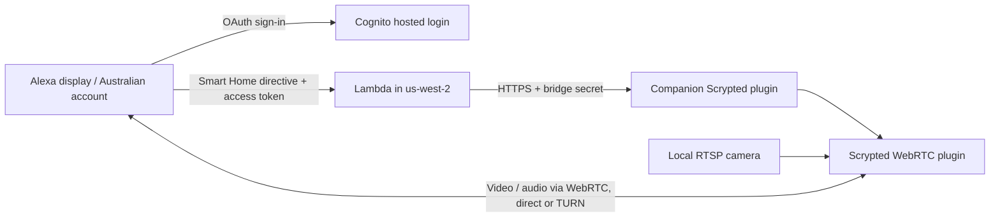

# Personal Scrypted Alexa camera skill for Australia

This project creates an `en-AU` Alexa Smart Home development skill, an AWS CDK backend, and a companion Scrypted plugin. It is intended for your own Australian Amazon account and selected cameras on one Scrypted server. The official Scrypted Alexa skill is not needed.

Alexa's Australian Smart Home endpoint uses **Far East (`FE`) / AWS Oregon (`us-west-2`)**. This is hardcoded in the CDK app and skill manifest generator. [Amazon's endpoint region mapping](https://developer.amazon.com/docs/alexaplus/smarthome/implement-your-addon.html).



Lambda verifies the Cognito access token's signature, issuer, client ID, token type, expiry and camera scope, then forwards signaling to a fixed HTTPS endpoint. Video stays out of Lambda. Cognito self-registration is disabled; every administrator-created user in this dedicated pool has access to the cameras selected in the plugin. This is a single-household design, not a multi-tenant service.

## Included

- CDK: Lambda, Cognito hosted login with authorization-code flow, generated bridge secret, least-privilege secret read access, and seven-day Lambda logs.
- Scrypted plugin: explicit camera selection, authenticated endpoint, discovery, retrievable health, WebRTC offers/answers, duplicate-session handling and cleanup.
- Project-local CDK, ASK CLI and Scrypted SDK, plus helpers for development skill creation, account linking and user provisioning.
- Tests for authorization, forwarding failures, discovery, WebRTC lifecycle, regional configuration and AWS resource policies.

The original installation has been tested with account linking, discovery and live camera playback. A fresh deployment into a second account has **not** been validated. Follow the checks below for your own server and display; camera codecs and NAT traversal depend on your environment.

## 1. Prerequisites

You need Node.js 22 or newer, AWS CLI v2 with a chosen authenticated profile, an Amazon Developer account using the same Amazon account as your Alexa devices, and a working Scrypted camera. Use a display capable of showing cameras, such as an Echo Show; an Echo Dot alone has no video display.

In Scrypted, add your **RTSP** camera and confirm live view works. Install the **WebRTC** plugin and enable its extension for that camera. Start with an H.264 stream and supported audio; Scrypted may need to transcode incompatible codecs. Leave TURN enabled in the WebRTC plugin when your network needs a relay. An HTTPS tunnel only carries signaling; it does not solve WebRTC media connectivity by itself.

Run commands from a macOS/Linux development computer (or WSL2) that can reach your Scrypted server. The original development platform was macOS; other platforms have not been verified end to end. The server may be any supported Scrypted installation. Uploading the plugin does not require rebuilding the Scrypted Docker image. Keep its data volume persistent.

Start with a clone of this repository and `cd` into it. For AWS CLI installation, profile creation, deployment permissions and Alexa developer registration, follow [account setup](docs/aws-setup.md). All addresses below are examples: replace them with your own.

Prepare a local environment file once:

```sh
npm ci
cp -n .env.local.example .env.local
chmod 600 .env.local
```

Edit `.env.local` in your editor:

```dotenv
AWS_PROFILE=camera-deploy
ASK_PROFILE=default
SCRYPTED_HOST=192.168.1.100:10443
SKILL_NAME="My Scrypted Cameras"
ALEXA_VENDOR_ID=
SCRYPTED_ENDPOINT=https://cameras.example.com/endpoint/scrypted-alexa-au/public/
CAMERA_LOGIN_EMAIL=your-email@example.com
ALEXA_SKILL_ID=
```

Set `AWS_PROFILE` to your actual personal profile name (the example uses `camera-deploy`). `SCRYPTED_HOST` is the LAN address for installation; `SCRYPTED_ENDPOINT` must be your real public HTTPS hostname and plugin path for AWS requests. Fill `CAMERA_LOGIN_EMAIL` with the address you want to use for the separate camera login. Leave `ALEXA_SKILL_ID` empty for a new skill.

All root deployment helpers (`aws`, `ask`, `cdk`, `synth`, `deploy`, `configure`, `skill`, `user`, `scrypted:*`, and `bridge:secret`) load `.env.local` automatically. **Do not source the file in your shell.** Existing shell variables override `.env.local`; nonempty configuration variables override `config.local.json`. Blank `ALEXA_SKILL_ID` preserves the ID saved during creation. Raw `aws`, `ask`, or workspace commands do not use this loader.

Verify your AWS profile and authenticate ASK:

```sh
npm run aws -- configure list-profiles
npm run aws -- sts get-caller-identity
npm run ask -- configure
npm run ask -- smapi get-vendor-list
```

If your AWS profile uses SSO and has expired, run `npm run aws -- sso login` first. Check the account ID from `get-caller-identity`. Set `ALEXA_VENDOR_ID` to the vendor ID for your selected ASK developer profile, then save `.env.local`. The ASK configuration command is interactive and may open a browser; choose the Amazon account used by your Alexa devices. CDK handles AWS deployment for this project.

The AWS region is intentionally fixed to `us-west-2` for Australian Alexa, regardless of your profile's default region. Do not add AWS access keys, Scrypted passwords, or Cloudflare tunnel tokens to the project. `.env.local` is ignored by Git; the example file is safe to track.

## 2. Install the companion plugin and expose its endpoint

```sh
npm run build
npm run scrypted:login
npm run scrypted:deploy
```

Sign in with your Scrypted administrator credentials when prompted (not your AWS or Jetson SSH credentials). The login command may prompt to download Scrypted's CLI on first use. Scrypted's SDK deploy CLI uses that saved login. Run these from a trusted local network; that upstream deploy CLI permits Scrypted's local self-signed certificate. The generated upload is `scrypted-plugin/dist/plugin.zip`.

Open your Scrypted console (for example `https://192.168.1.100:10443`), then **Personal Alexa Cameras (AU)** in Scrypted and select your camera. Copy the **Local plugin endpoint** setting. Publish only that plugin endpoint through your existing HTTPS reverse proxy or tunnel. A typical path is:

```text
https://cameras.your-domain.example/endpoint/scrypted-alexa-au/public/
```

Use the actual path reported by Scrypted. Preserve the path, POST body and `Authorization` header. The externally visible certificate must validate normally; the Lambda relay will reject invalid certificates and redirects. Avoid routing the Scrypted management UI through this endpoint. Until the bridge secret is configured, requests receive HTTP 401.

For a complete Cloudflare installation, DNS, origin TLS and service example, follow [the tunnel guide](docs/cloudflare-tunnel.md) and use [the sample configuration](examples/cloudflared/config.yml).

For Cloudflare Tunnel, run `cloudflared` on the Scrypted host or another always-on LAN host and route only this plugin path to `https://192.168.1.100:10443`; unmatched paths should return 404. Configure the tunnel connector to trust the local Scrypted certificate. The hostname's public certificate must validate normally. Preserve the `Authorization` header and avoid an interactive Cloudflare Access login on this machine-to-machine endpoint; our plugin authenticates it with the bridge secret. If you add Cloudflare Access service-token authentication, Lambda needs corresponding headers, which this project does not currently send.

**Cloudflare Bot Fight Mode:** standard Bot Fight Mode can challenge AWS and break discovery or stream setup. It cannot be bypassed by a path-specific WAF Skip rule; disable it if it blocks the integration, or use a product that supports scoped exceptions. See [the tunnel guide](docs/cloudflare-tunnel.md#3-configure-cloudflare-security).

Set the resulting full URL in `SCRYPTED_ENDPOINT` in `.env.local`. The tunnel/reverse proxy and DNS are environment-specific and are not provisioned by this CDK stack. No camera RTSP port needs to be exposed for this bridge. The tunnel carries signaling, not the WebRTC video stream.

## 3. Configure and deploy AWS

```sh
npm run configure:env
npm run check
npm run cdk -- bootstrap --region us-west-2
npm run deploy
```

`configure:env` reads your environment values without prompts, validates them, and writes ignored `config.local.json`. It derives the three Alexa authorization-code redirect URLs from `ALEXA_VENDOR_ID`. Verify those URLs against **Build → Account Linking → Alexa Redirect URLs** after creating the skill. If they differ, set `ALEXA_REDIRECT_URLS` in `.env.local` to a JSON array of the exact URLs, run `configure:env`, and redeploy. The older interactive `npm run configure` command remains available, but environment overrides still apply. `npm run check` builds, tests and synthesizes; it does not deploy.

The first deployment intentionally has no Alexa invocation permission: the skill ID does not exist yet. Outputs are saved to `.local/cdk-outputs.json`. No secret values are placed in CloudFormation outputs. Deployment creates billable AWS resources, including Secrets Manager, and a CDK bootstrap stack when needed.

Retrieve the generated bridge secret into a local file:

```sh
npm run bridge:secret
```

Open `.local/bridge-secret.txt` locally and paste its contents into the companion plugin's **Bridge secret** setting. The helper writes mode 0600 and does not print the secret. Alternatively, use the AWS Secrets Manager console with the `BridgeSecretArn` output. It is a raw string, not JSON. Rotation requires updating both Scrypted and Secrets Manager; Lambda caches it for up to a minute.

## 4. Create the Alexa development skill and link its backend

```sh
npm run skill -- prepare
```

Review `.local/skill.json`, then create the development skill:

```sh
npm run skill -- create
npm run skill -- status
```

Wait for the initial manifest status to become `SUCCEEDED`, then attach the backend:

```sh
npm run deploy
npm run skill -- update
npm run skill -- status
```

Creation first reserves the skill ID with a manifest that omits the Lambda endpoints. The second deployment adds its restricted trigger; `skill -- update` then attaches the endpoints for validation. Wait for the manifest status to become `SUCCEEDED`, then:

```sh
npm run skill -- link
```

`create` uses your selected ASK profile's vendor account and records the returned skill ID in local configuration. Wait for manifest validation to succeed after adding the trigger and resubmitting the manifest before configuring account linking. The second CDK deployment adds a Lambda permission restricted to that exact skill ID. `link` fetches the Cognito app client secret through your AWS profile and configures the skill's OAuth settings through ASK. Its generated `.local/account-linking.json` contains a secret and has mode 0600.

If skill creation succeeds but ID parsing fails, inspect `.local/skill-create-response.json`, copy its ID into `config.local.json`, and continue with the second deployment. Do not create a duplicate skill. To update an existing development manifest later, use `npm run skill -- update`.

Leave `ALEXA_SKILL_ID` blank after creation: the helper saves the ID in `config.local.json` and the next deployment reads it automatically. Set that environment variable only when targeting an existing skill. No command here submits the skill for certification or publishes it. This does not automatically repair the official Scrypted skill or change your Amazon marketplace.

## 5. Create your camera login and enable the skill

```sh
npm run user
```

`user` reads `CAMERA_LOGIN_EMAIL` from `.env.local` (or accepts an explicit email argument). This creates a dedicated Cognito user with a generated permanent password, saved in `.local/camera-login.json` with mode 0600. No invitation email is sent. This login is separate from both your Amazon and Scrypted logins. Run it once for a new user; an existing user is not reset automatically. `npm run user -- --status`, `--resume` and `--reset` support inspection, interrupted creation and intentional password replacement; see [recovery instructions](docs/operations.md#camera-login-status-recovery-and-reset). Keep the generated credentials in your password manager.

Verify the deployed connection before enabling the skill:

```sh
npm run diagnose
npm run diagnose -- --login
```

The first tests configuration and HTTPS from your computer; `--login` additionally uses your saved camera login to test discovery through the actual AWS Lambda. Neither starts a video stream. See [diagnostic behavior and limitations](docs/operations.md#deployment-verification).

In the Alexa Developer Console, confirm English (AU) and the **Far East** endpoint are configured, then enable development testing if the console offers that setting. In the Alexa app signed into the same Amazon developer account, open **Skills & Games → Your Skills → Dev**, choose the skill and enable it. Sign in using the generated Cognito camera login, then discover devices. UI labels can vary by Alexa app version.

Say **“Alexa, show the front door camera”**, using your camera's Scrypted name. Test both starting and stopping playback. Device discovery and WebRTC streaming are supported; proactive motion/doorbell announcements, snapshots and two-way talk are outside this implementation. It deliberately omits `alexa::async_event:write`, so no `AcceptGrant` exchange or Alexa Event Gateway credentials are needed. [Alexa RTCSessionController synchronous signaling](https://developer.amazon.com/docs/alexaplus/device-apis/alexa-rtcsessioncontroller.html).

## Troubleshooting and operational limits

| Symptom | Check |
| --- | --- |
| Skill missing in the app | Same Amazon account as ASK, Australian marketplace/locale, development skill visibility. |
| Account linking fails | Exact Cognito callback URLs, correct client secret, account-linking update completed, user password set. |
| Discovery is empty | Camera explicitly selected and WebRTC extension enabled so it exposes `RTCSignalingChannel`. |
| `INVALID_AUTHORIZATION_CREDENTIAL` | Disable/re-enable and relink the skill; ensure Cognito scopes include `cameras/access`. |
| `BRIDGE_UNREACHABLE` | Public HTTPS route, certificate, reverse proxy auth/header forwarding and matching bridge secret. |
| Camera discovered but video fails | Test Scrypted WebRTC playback, H.264/audio configuration, TURN and outbound media firewall rules. |
| Lambda invocation denied | Second deployment completed and `skillId` matches the developer console. |
| Stream stops after ten minutes | The plugin caps session lifetime to clean up abandoned sessions; start a new view. |

Synchronous signaling has a tight budget: plugin setup is limited to five seconds, the relay HTTP request to 6.5 seconds, and Lambda to eight seconds. A slow camera, TURN setup or cold start can exceed it. Use Scrypted prebuffering where appropriate. Supporting longer setup via asynchronous responses would require a separate Alexa Event Gateway implementation.

At most eight sessions run at once. Changes to camera selection require Alexa rediscovery; existing streams end on disconnect or expiry. Health reports use Scrypted's online state when available. All provisioned Cognito users share the selected cameras. JWT validation is offline: disabling a user or revoking refresh tokens does not invalidate an already-issued access token immediately; it can remain usable for its remaining fifteen-minute lifetime.

Lambda logs exclude access tokens, SDP, bridge secrets and raw upstream errors. Inspect the `LogGroupName` output when troubleshooting. Scrypted's own WebRTC diagnostics may contain connection details.

For discovery failures, Lambda logs distinguish secret lookup (`stage: secret`), HTTPS requests (`stage: https`), and response parsing (`stage: response`). An HTTP 403 at the HTTPS stage means a proxy or server rejected the request. A successful request from your own computer does not prove AWS can reach the same endpoint: this Lambda runs in Oregon, so country/IP restrictions can treat it differently. If Cloudflare is in front, search its Security Events for the logged `cloudflareRay` value and inspect the matched rule. `cloudflareChallenge: true` identifies a browser challenge, which this server-to-server request cannot complete. Standard Bot Fight Mode cannot be bypassed with a WAF Skip rule. For security products that support exceptions, scope any necessary exception to the plugin hostname, exact `/endpoint/scrypted-alexa-au/public/` path, and POST method; keep the plugin's bearer authentication enabled. See [Cloudflare challenge response headers](https://developers.cloudflare.com/cloudflare-challenges/challenge-types/challenge-pages/detect-response/).

Run `npm audit` and `npm audit --omit=dev` for current dependency findings; the latter covers declared production dependencies, while some of those also serve deployment tooling. Review findings before updating the lockfile.

## Maintenance and recovery

See [operations](docs/operations.md) for missing outputs, failed deployments/skill creation, password reset, upgrades/rollback, credential rotation and complete cleanup. `npm run outputs:refresh` recovers local outputs from an existing completed stack; it does not deploy resources.

Before publishing a fork, run `npm run release:check`. The repository intentionally excludes runtime configuration and credentials.

## Cleanup

Disable the development skill in Alexa, remove it through the developer console when no longer needed, remove the companion plugin and HTTPS route, and run `npm run cdk -- destroy`. The Cognito pool and bridge secret are retained to avoid accidentally losing account data; delete those separately in AWS if desired. The CDK bootstrap resources are also independent of this stack. Remove the secret-bearing `.local` files when you no longer need them.

## References

- [Scrypted Alexa plugin and signaling source](https://github.com/koush/scrypted/tree/main/plugins/alexa) — reference for Scrypted's WebRTC integration; the bridge is a separate implementation.
- [ASK CLI command reference](https://developer.amazon.com/en-US/docs/alexa/smapi/ask-cli-command-reference.html).
- [Alexa account linking schema and redirect URLs](https://developer.amazon.com/en-US/docs/alexa/smapi/account-linking-schemas.html).
- [Alexa skill manifest schema](https://developer.amazon.com/en-US/docs/alexa/smapi/skill-manifest.html).
- [CDK Cognito app clients](https://docs.aws.amazon.com/cdk/api/v2/docs/aws-cdk-lib.aws_cognito.UserPoolClient.html).
